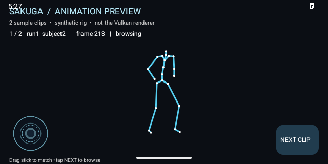

<div align="center">
  

  <sub>Illustrative concept art — not an in-engine screenshot.</sub>

  # Sakuga Engine

  **An animation and rendering sandbox for expressive, anime-inspired characters.**

  Vulkan · C++20 · Motion matching · VRM · ImGui

  [Download the Windows preview](https://github.com/Jacinth-19/SakugaEngine/releases/tag/v0.1.0-preview) · [Getting started](#get-started) · [Developer guide](docs/ENGINE_GUIDE.md) · [Platform status](#platform-status)
</div>

---

## Get started

### Windows x64

1. Open the **[Windows preview release](https://github.com/Jacinth-19/SakugaEngine/releases/tag/v0.1.0-preview)** and download either the installer (`.exe`) or the portable `.zip`.
2. Run the installer, or extract the **whole** portable archive to a folder you can write to. Launch **Sakuga Engine** or `sandbox.exe`.
3. You need a **Vulkan 1.3-capable GPU and a current graphics driver**. The installer does not include the Vulkan runtime or driver.

> **Preview:** the Windows executable is built and command-line smoke-tested in GitHub Actions, but gameplay, rendering and the installer UI still need validation on a real Windows GPU. The release is **unsigned** and Windows may warn about an unknown publisher. [Signing and hardware test details](docs/WINDOWS_SIGNING_AND_TESTING.md).

### Find your way around

| Control | Action |
| :--- | :--- |
| **Tab** | Release or capture the mouse |
| **F1 / F2 / F3** | Hide the UI / take a screenshot / toggle the FPS counter |
| **F11 / F12** | Open the ImGui demo / open the theme editor |
| **Esc** | Quit |

Open **Motion matching** to see the current animation and loaded clip count. Open **Device and performance** for CPU, RAM, storage space, GPU and frame statistics. Some values may be unavailable; HDD versus SSD is not currently detected. Press **F12** to explore the live theme editor. Saving a theme beside an installed app may require a writable location; the portable build is convenient for experiments.

## See the sandbox

These are existing desktop sandbox captures, not the illustrative banner above. Their original capture environment was not recorded, so they do **not** prove that the current Windows release passed a gameplay test.

| Day | Night |
| :---: | :---: |
|  |  |
| **Character** | **Editor** |
|  |  |

**Earlier desktop demos:** [Motion lab video](docs/demo_motion_lab.mp4) · [Motion matching video](docs/demo_motion_matching.mp4). These are previously committed footage, not new verification of the current Windows build.

### Android emulator — animation preview



[Watch the Android emulator preview](docs/media/android_preview.mp4) · [Build and emulator test run](https://github.com/Jacinth-19/SakugaEngine/actions/runs/41331384579)

Captured from the Android emulator on 1 November 2026. It shows the **two-clip synthetic-rig preview**, not the full mobile game or Vulkan renderer. The run checked startup and a touch on **Next Clip**; a physical Android device has not yet been tested. See [media provenance](docs/media/README.md).

## Explore

- **Animation** — BVH motion matching, inertialized transitions, IK, spring bones and a motion lab with NPCs.
- **Rendering** — anime-inspired shading, outlines, face lighting, shadows, HDR lighting and post-processing.
- **Authoring** — live ImGui themes, a material inspector and runtime debug views.
- **Diagnostics** — loaded animation count and device/frame information to help investigate performance.

### About the 77 animations

The Windows preview includes **two sample clips**. The full LAFAN1 library is a separate download and is **CC BY-NC-ND 4.0, non-commercial use only**. From a source checkout, run:

```bash
./tools/fetch_assets.sh --motion-only
```

On Windows, use a Bash environment such as Git Bash. The script belongs to the **source checkout**, not the installed app. It downloads the clips to `~/.cache/lafan1` by default; you can also point the app at a directory with `--motion-dir DIR`. The app shows the number actually loaded. See [animation testing and diagnostics](docs/ANDROID_AND_DIAGNOSTICS.md) for how the 77-clip test and skeletal debug video work.

## Platform status

| Platform | Status |
| :--- | :--- |
| **Windows x64** | Preview installer and portable archive; CI build and GPU-free smoke tests pass. Real-device visual testing remains. |
| **Android** | An **experimental animation-only debug APK** is built by GitHub Actions; see the [Android notes](docs/ANDROID_AND_DIAGNOSTICS.md). It is not the full Vulkan/VRM desktop sandbox and is not a production release. |
| **Linux** | Source build exists; no release package is provided yet. |
| **macOS** | No release package or verified build is provided yet. |

See the [Android and diagnostics notes](docs/ANDROID_AND_DIAGNOSTICS.md) for the porting gaps and the limits of the device stats.

## Build & test

Most source dependencies and precompiled shaders are in the repository; building the application still needs the platform toolchain and Vulkan loader/SDK. For the Windows recipe, other prerequisites, shader tools and detailed configuration, see the [developer guide](docs/ENGINE_GUIDE.md).

The test suite runs without a GPU:

```bash
cmake -S tests -B build-tests -DCMAKE_BUILD_TYPE=Release
cmake --build build-tests --parallel
ctest --test-dir build-tests --output-on-failure
```

The Android preview build is available as an artifact on successful **Android animation preview** workflow runs. The full-motion tests skip if the separately downloaded clip library is absent. Passing GPU-free tests does **not** replace visual testing on a real device.

## More information

- [Developer guide](docs/ENGINE_GUIDE.md) — source builds, themes, animation and test details
- [Installer guide](docs/INSTALLER.md) — Inno Setup styling and iteration
- [Android & diagnostics](docs/ANDROID_AND_DIAGNOSTICS.md) · [Full Android port plan](docs/ANDROID_PORT_PLAN.md)
- [Windows signing & gameplay testing](docs/WINDOWS_SIGNING_AND_TESTING.md) — what has and has not been verified
- [Shader port notes](docs/SHADER_PORT.md) · [Script audit](docs/SCRIPT_AUDIT.md) · [Third-party dependencies](third_party/README.md)

## Licences

LAFAN1 mocap is **CC BY-NC-ND 4.0**; review its terms before use or redistribution. Other included assets and dependencies have their own licences; see the [developer guide](docs/ENGINE_GUIDE.md#licences) and [third-party notes](third_party/README.md).
