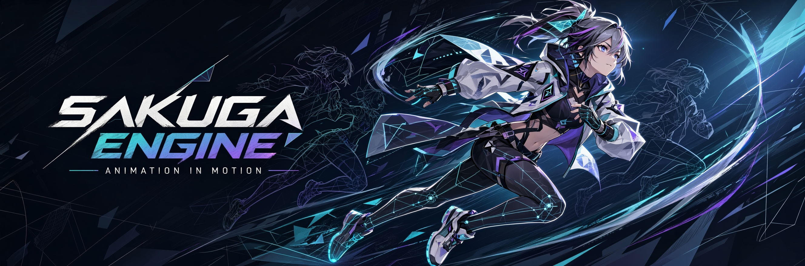
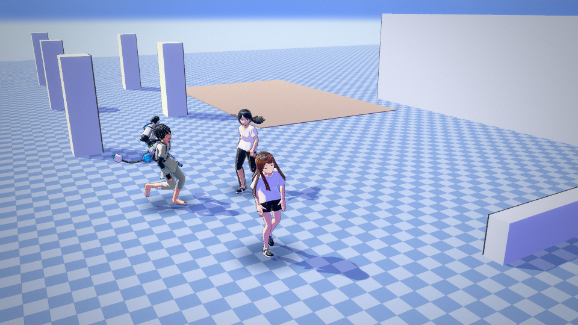
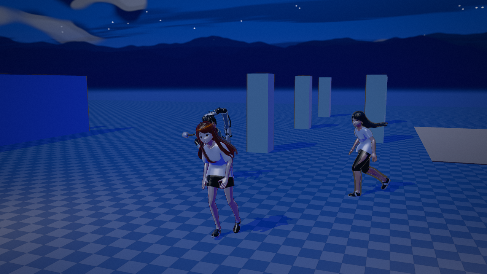
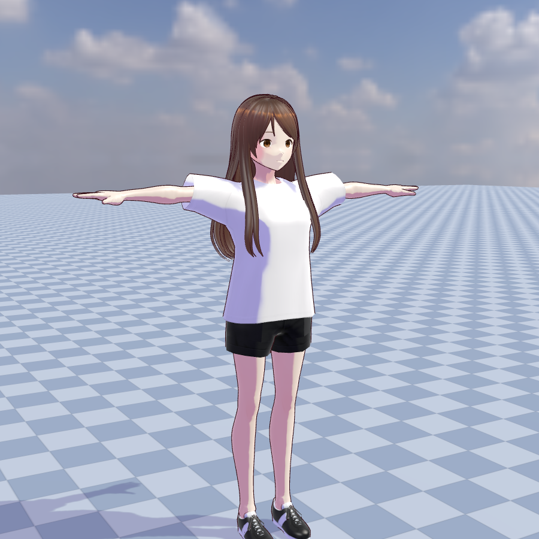
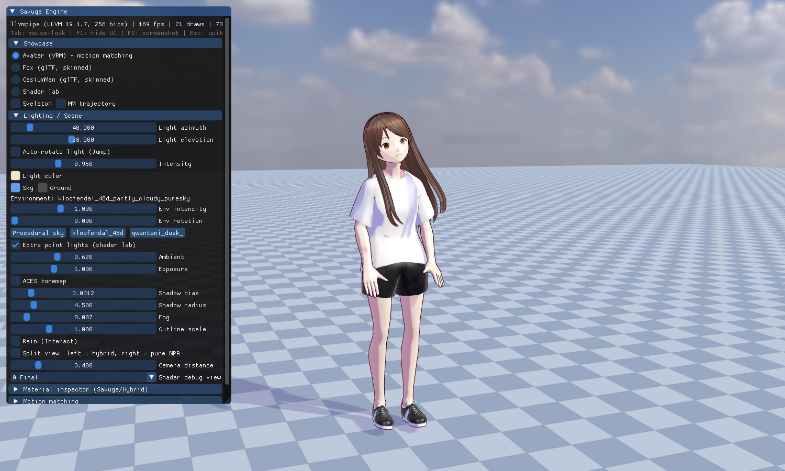
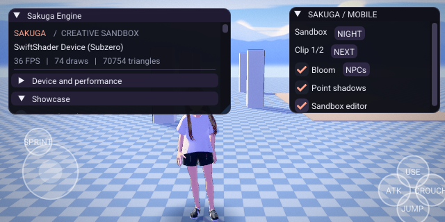

<div align="center">
  

  <sub>Illustrative concept art — not an in-engine screenshot.</sub>

  # Sakuga Engine

  **An animation and rendering sandbox for expressive, anime-inspired characters.**

  Vulkan · C++20 · Motion matching · VRM · ImGui

  [Full-library builds](#get-started) · [Getting started](#get-started) · [Developer guide](docs/ENGINE_GUIDE.md) · [Platform status](#platform-status)
</div>

---

## Get started

### Windows x64

1. Open the latest successful **[full-library Windows build](https://github.com/Jacinth-19/SakugaEngine/actions/workflows/windows.yml?query=branch%3Aarena%2Fa13c5e34-sakugaengine)** and download the `sakuga-windows-x64` artifact (GitHub sign-in may be required). It contains an installer and a portable ZIP.
2. Run the installer, or extract the **whole** portable archive to a folder you can write to. Launch **Sakuga Engine** or `sandbox.exe`.
3. You need a **Vulkan 1.3-capable GPU and a current graphics driver**. The installer does not include the Vulkan runtime or driver. The older [Windows release](https://github.com/Jacinth-19/SakugaEngine/releases/tag/v0.1.0-preview) has only two clips.

> **Preview:** the Windows executable is built and command-line smoke-tested in GitHub Actions, but gameplay, rendering and the installer UI still need validation on a real Windows GPU. The release is **unsigned** and Windows may warn about an unknown publisher. [Signing and hardware test details](docs/WINDOWS_SIGNING_AND_TESTING.md).

### Android

Download `sakuga-android-animation-preview-debug` from the latest successful **[full-library Android build](https://github.com/Jacinth-19/SakugaEngine/actions/workflows/android.yml?query=branch%3Aarena%2Fa13c5e34-sakugaengine)**, extract the ZIP and install the APK on a compatible Android device. This debug-signed preview was tested on an x86_64 emulator, not a physical phone; it is not a Play Store release. Installing updates from builds signed with different debug keys may require uninstalling the previous APK. Allow substantial storage and first-run processing time.

### Find your way around

| Control | Action |
| :--- | :--- |
| **Tab** | Release or capture the mouse |
| **F1 / F2 / F3** | Hide the UI / take a screenshot / toggle the FPS counter |
| **F11 / F12** | Open the ImGui demo / open the theme editor |
| **Esc** | Quit |

For a lighter Windows starting point, launch **Sakuga Engine - Performance** from the Start menu, or run `Sakuga-Performance.bat` from the portable folder. It starts at 1280 × 720, without NPCs, spring bones, point-light shadows or bloom; the normal launcher is unchanged. This is not a guarantee of 60 FPS and still requires Vulkan 1.3.

Open **Motion matching** to browse every loaded animation on Windows. On Android, tap **CLIPS** in the Vulkan panel (or the Canvas fallback) to choose an animation by name. Moving resumes motion matching. The Vulkan mobile panel also exposes **Hair physics** and an **Upright** adjustment; neither is available in the synthetic Canvas fallback. Open **Motion matching** to see the current animation and loaded clip count. Open **Device and performance** for CPU, RAM, storage space, GPU and frame statistics. Some values may be unavailable; HDD versus SSD is not currently detected. Press **F12** to explore the live theme editor. Saving a theme beside an installed app may require a writable location; the portable build is convenient for experiments.

## See the sandbox

These are existing desktop sandbox captures, not the illustrative banner above. Their original capture environment was not recorded, so they do **not** prove that the current Windows release passed a gameplay test.

| Day | Night |
| :---: | :---: |
|  |  |
| **Character** | **Editor** |
|  |  |

**Earlier desktop demos:** [Motion lab video](docs/demo_motion_lab.mp4) · [Motion matching video](docs/demo_motion_matching.mp4). These are previously committed footage, not new verification of the current Windows build.

### Android emulator — Vulkan sandbox



Captured from the x86_64 Android emulator using SwiftShader on 2 November 2026. The [build and emulator run](https://github.com/Jacinth-19/SakugaEngine/actions/runs/41520145068) checked editor input, avatar movement, clip selection, four point-light shadow maps, NPC loading and background/resume. This is not a physical-phone test. The screenshot predates a frame-timing correction, so its FPS figure is not a performance measurement. The [earlier Canvas-only preview](docs/media/android_preview.mp4) and its [provenance](docs/media/README.md) remain available.

## Explore

- **Animation** — BVH motion matching, inertialized transitions, IK, spring bones and a motion lab with NPCs.
- **Rendering** — anime-inspired shading, outlines, face lighting, shadows, HDR lighting and post-processing.
- **Authoring** — live ImGui themes, a material inspector and runtime debug views.
- **Diagnostics** — loaded animation count and device/frame information to help investigate performance.

### About the 77 animations

Current Windows CI installer/portable builds and the Android debug APK are built with **all 77 LAFAN1 BVH clips**, verified byte-for-byte before packaging. The older [Windows release](https://github.com/Jacinth-19/SakugaEngine/releases/tag/v0.1.0-preview) still contains only two clips; use the latest successful [Windows workflow artifact](https://github.com/Jacinth-19/SakugaEngine/actions/workflows/windows.yml?query=branch%3Aarena%2Fa13c5e34-sakugaengine) for the full library. The Android Vulkan sandbox and its separate synthetic-rig Canvas fallback both load all 77 clips.

LAFAN1 is by Ubisoft La Forge and is **CC BY-NC-ND 4.0: non-commercial use only; no sharing adapted material**. See [attribution and license](assets/licenses/LAFAN1-NOTICE.txt). First launch builds a large motion cache; allow substantial disk space and memory. The app's Motion matching panel reports its actual loaded count.

The clips remain outside this Git repository (~333 MB). To build from source, run `./tools/fetch_assets.sh --motion-only` (Git Bash on Windows). The Android build verifies that cache automatically; for a Windows install tree, run `python tools/stage_lafan1.py --source "$HOME/.cache/lafan1" --dest stage/assets/motion` after `cmake --install`. The CI workflows do this staging when producing artifacts. See [Android and diagnostics](docs/ANDROID_AND_DIAGNOSTICS.md) and the [developer guide](docs/ENGINE_GUIDE.md).
## Platform status

| Platform | Status |
| :--- | :--- |
| **Windows x64** | Preview installer and portable archive; CI build and GPU-free smoke tests pass. Real-device visual testing remains. |
| **Android** | An **experimental Android debug APK** runs the shared Vulkan sandbox, MotionLab, VRM and ImGui editor on compatible devices, with mobile touch controls and a Canvas fallback if Vulkan setup fails. Some desktop features and assets are disabled or omitted on mobile; see the [Android notes](docs/ANDROID_AND_DIAGNOSTICS.md). No physical phone has been tested. |
| **Linux** | Source build exists; no release package is provided yet. |
| **macOS** | No release package or verified build is provided yet. |

See the [Android and diagnostics notes](docs/ANDROID_AND_DIAGNOSTICS.md) for the porting gaps and the limits of the device stats.

## Build & test

Most source dependencies and precompiled shaders are in the repository; building the application still needs the platform toolchain and Vulkan loader/SDK. For the Windows recipe, other prerequisites, shader tools and detailed configuration, see the [developer guide](docs/ENGINE_GUIDE.md).

The test suite runs without a GPU:

```bash
cmake -S tests -B build-tests -DCMAKE_BUILD_TYPE=Release
cmake --build build-tests --parallel
ctest --test-dir build-tests --output-on-failure
```

The Android debug APK is available as an artifact on successful **Android sandbox** workflow runs. The full-motion test skips locally if the separately downloaded clip library is absent; CI fetches and verifies it. Passing GPU-free tests does **not** replace visual testing on a real device.

## More information

- [Developer guide](docs/ENGINE_GUIDE.md) — source builds, themes, animation and test details
- [Installer guide](docs/INSTALLER.md) — Inno Setup styling and iteration
- [Android & diagnostics](docs/ANDROID_AND_DIAGNOSTICS.md) · [Full Android port plan](docs/ANDROID_PORT_PLAN.md)
- [Windows signing & gameplay testing](docs/WINDOWS_SIGNING_AND_TESTING.md) — what has and has not been verified
- [Shader port notes](docs/SHADER_PORT.md) · [Script audit](docs/SCRIPT_AUDIT.md) · [Third-party dependencies](third_party/README.md)

## Licences

LAFAN1 mocap is **CC BY-NC-ND 4.0**; review its terms before use or redistribution. Other included assets and dependencies have their own licences; see the [developer guide](docs/ENGINE_GUIDE.md#licences) and [third-party notes](third_party/README.md).

### Frame benchmark

On Android Vulkan tap **BENCH**, or on Windows use **Frame benchmark** in the sandbox editor. Run it with the scene and camera unchanged, then use **Share report** (Android) or **Copy report** (Windows). It reports wall-clock frame-loop statistics, not GPU timings; vsync can cap results. The Android Canvas fallback does not benchmark the 3D renderer. See [Android and diagnostics](docs/ANDROID_AND_DIAGNOSTICS.md) for methodology and Mixamo asset limitations.

The sandbox has four editable, savable sky profiles, configurable atmosphere parameters, an integrated single-scattering option, an optional basic 3D cloud raymarch, and delayed GPU sky-draw timing where supported. The compact Android **SKY** panel exposes scattering controls. These are not the full proposed AnimeSky atmosphere/cloud architecture; see [sky details and limitations](docs/ANIME_SKY.md). Windows also includes `sakuga-fbx-info.exe` for offline FBX inspection; it does not yet import or render FBX. See [diagnostics](docs/ANDROID_AND_DIAGNOSTICS.md).

### AnimeSky post-processing

The renderer uses a separate Vulkan HDR post-processing module with optional per-material selective bloom, depth-based atmospheric fog and depth of field, halation, tone mapping, grading and optional stylised finishing. The editor also reports delayed GPU post-processing time when supported, with an opt-in approximate per-stage breakdown. Android has individual controls in its POST panel. Four editable creative presets are in **Post-processing (HDR)**. These are initial profiles, not reproductions of named games. See [pipeline details and limitations](docs/POST_PROCESSING.md) and the [reference index](reference/AnimeSky_Reference_Images/README.md); external reference images are not bundled.
