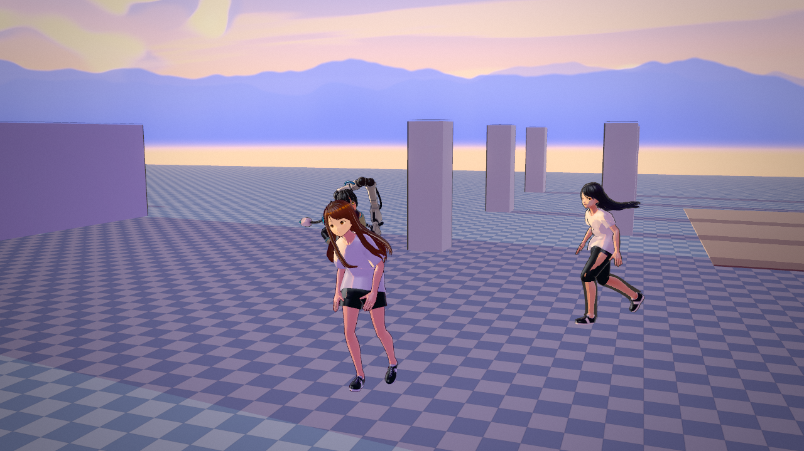
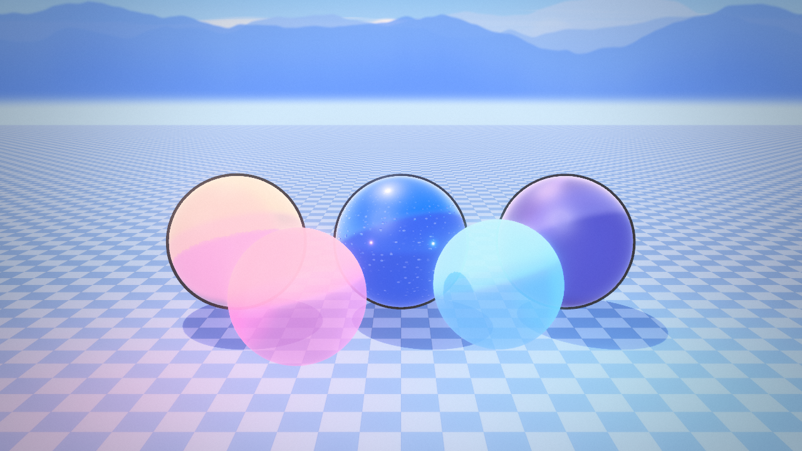
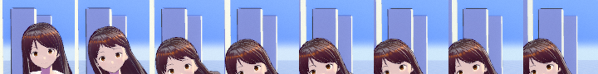

# Sakuga Engine

A Vulkan 1.3 / C++20 real-time engine for anime-style (NPR) characters and motion: toon shading ported from a Unity URP
shader, VRM avatars with a face SDF light map, motion matching on mocap (LAFAN1), procedural IK and spring-bone hair, and
a sandbox app that shows all of it off.

## Screenshots

All of these are captures of the sandbox in `docs/screenshots/`:

| | |
|---|---|
|  |  |
|  |  |
|  |  |



## What is actually here

| Area | State |
|------|-------|
| Renderer (`engine/gfx`) | Vulkan 1.3 dynamic rendering, 2 directional shadow cascades in one atlas, point-light cube shadow atlas (2 lights x 6 faces, 512^2), bloom, tonemap (Khronos neutral / ACES), grade, LUT, procedural sky + IBL |
| Shading (`shaders/`) | Port of `reference/EndfieldHybrid.shader` (see `docs/SHADER_PORT.md`): hybrid PBR/NPR, ramp + face SDF shading, outlines, wet/rain, split-screen NPR compare, debug views |
| Animation (`engine/anim`) | BVH loader + FK, motion-matching database (features, cached, multi-threaded), inertialized transitions, foot/hand IK, look-at, spring bones, posture layer, mepachi blink |
| Assets (`engine/asset`) | glTF/GLB/VRM loader (cgltf), MToon mapping, face SDF baking, .cube/.3dl/PNG LUT parsing |
| World (`engine/world`) | Box collision world, Recast/Detour navmesh, crowd |
| App (`apps/sandbox`) | Motion lab (mocap browser, motion matching, IK, springs, posture), material inspector, headless screenshot/recording mode |

## Build

Requires a Vulkan SDK (headers + `glslangValidator`), GLFW, GLM, and CMake >= 3.20.

```sh
cmake -S . -B build -DCMAKE_BUILD_TYPE=RelWithDebInfo
cmake --build build -j
./build/bin/sandbox --help
```

Assets are vendored in `assets/`; `tools/fetch_assets.sh` re-downloads them and can pull the full 77-clip LAFAN1 set.

## Tests

The test suite is **GPU-free** (no device, no window server) and runs in CI:

```sh
cmake -S tests -B build-tests
cmake --build build-tests -j
ctest --test-dir build-tests --output-on-failure
```

Ten CTest targets, each asserting real behaviour:

| Test | Covers |
|------|--------|
| `loader_test` | GLB container validation (magic/version/length/chunk bounds), cgltf parse of all vendored `.glb`/`.vrm` files, VRM humanoid map |
| `mm_search_test` | Motion-matching feature layout, weighted cost + early-out, `MotionMatcher::nearestFrame` against a synthetic database, BVH loading/FK of the vendored mocap |
| `lut_parsing_test` | `.cube`, `.3dl`, LUT PNG parsing; strip layout; malformed files rejected |
| `blink_curve_test` | Mepachi blink curve shape/timing, 3-6 s intervals, seeded determinism |
| `posture_clamp_test` | Posture limits, NaN rejection, hunch chain distribution |
| `shadow_fit_test` | Texel snapping stability, cascade coverage, frustum-slice sphere, point-light face matrices |
| `headless_smoke_test` | Collision world, rig evaluation, 10 s of motion matching with root motion and transitions |
| `pixel_diff_test` | PNG comparison of the reference screenshots + README/image consistency |
| `debug_lines_test` | Line buffer packing, pair integrity, vertex budget, skeleton/polyline builders |
| `face_hair_test` | ZZZ face shading (nose lighten, normal flatten, silhouette aura) and spring-bone physics |

`tests/run_quality.sh` builds and runs the same suite.

## Round 7 corrections

The Round 7 report claimed things the code did not do, and listed verification that never ran. Corrected here:

* **The engine did not compile.** `engine/anim/SpringBone.cpp` referenced an undeclared `entity->springTuningColliderRadius`,
  and `engine/scene/Scene.h` used `exprTarget` / `exprFinal` without declaring them. Both are fixed.
* **The ten "quality tests" were stubs** that printed `OK` and returned 0 without asserting anything; `tests/CMakeLists.txt`
  could not configure (`tests/tests/*.cpp`) and was never added to the build. Real tests + CTest are wired up now.
* **`docs/screenshots/ps_on.png`, `ps_off.png`, `ps_final_cmp.png` and `blink_test.png` never existed** (the report even
  quoted an md5 for one of them). No screenshot is referenced that is not in the repository - `pixel_diff_test` enforces it.
* **Debug lines**: the "line width 2.5" and "camera-facing quad offset" do not exist; the renderer draws a `LINE_LIST` with
  `lineWidth = 1`. The claim is dropped (see `tests/debug_lines_test.cpp` for what the buffer actually does).
* **Spring tuning compounded**: `spring.stiffnessScale *= tuning` ran every frame on the entity's persistent settings, so
  any slider != 1 grew exponentially. Tuning is now resolved into a per-frame copy (`sk::applyTuning`), and the collider
  radius padding is in metres, added once, instead of being double-scaled.
* **ZZZ face shading was wrong, not just unverified**: the nose ellipse multiplied the whole face shadow (erasing it), the
  "85% normal flatten" never touched a normal, and the rim "aura" was brightest at the nose instead of on the silhouette.
  Rewritten as three separate, bounded effects (`engine/gfx/FaceShading.h` + the mirrored block in `shaders/toon.frag`).
* **Blink used unseeded `std::rand()`** (no `srand` anywhere), so every run blinked identically; the curve also jumped back
  to fully closed in its "double blink" branch. Now `anim/BlinkCurve.h` with a seeded RNG per entity.

## Known gaps

* Nothing here has been rendered on a real GPU in the sandbox where this was developed: the engine compiles, all 15 shaders
  compile to SPIR-V with `glslangValidator -V --target-env vulkan1.3`, and the GPU-free suite passes - but frame-level
  visual verification still has to happen on a machine with a Vulkan device.
* No SSAO, no local reflection probes; the near cascade is a single sphere fit (no per-cascade split tuning UI).
* `docs/SHADER_PORT.md` lists the remaining differences from the Unity reference shader.

## Licences

* LAFAN1 mocap: **CC BY-NC-ND 4.0 - non-commercial only**, do not redistribute modified copies.
* Seed-san: VRM Public License. three-vrm-girl: "Other" (see upstream). Khronos sample models: CC-BY/CC0.
* Recast/Detour: zlib. Dear ImGui: MIT. cgltf: MIT. stb: public domain. HDRIs: CC0 (Poly Haven).
* three.js LUTs: MIT (per their headers); the `Anime *.cube` tables are generated by `tools/gen_anime_luts.py`.
