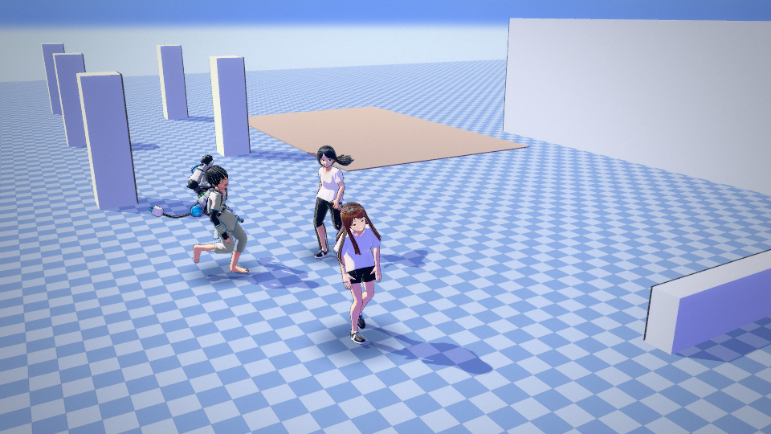
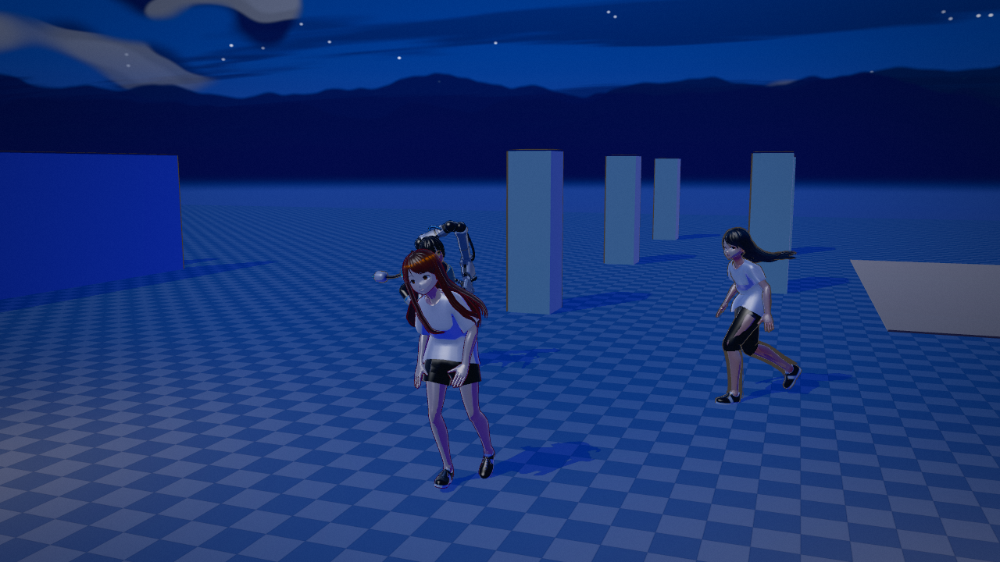
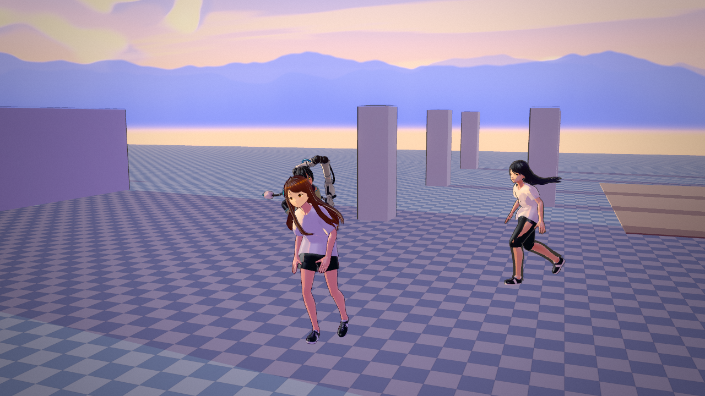
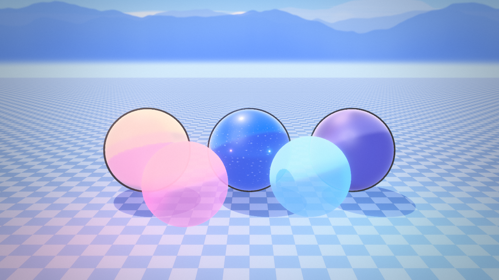
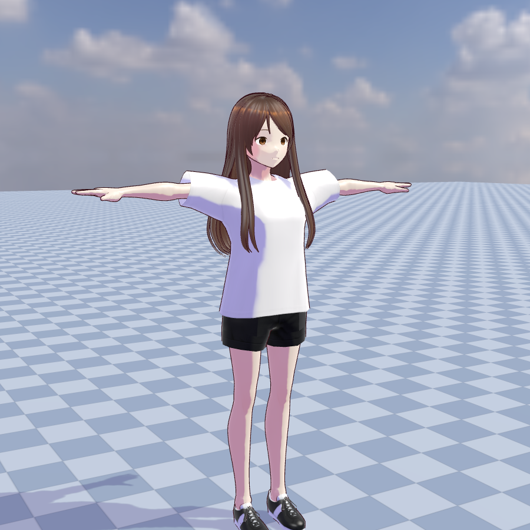
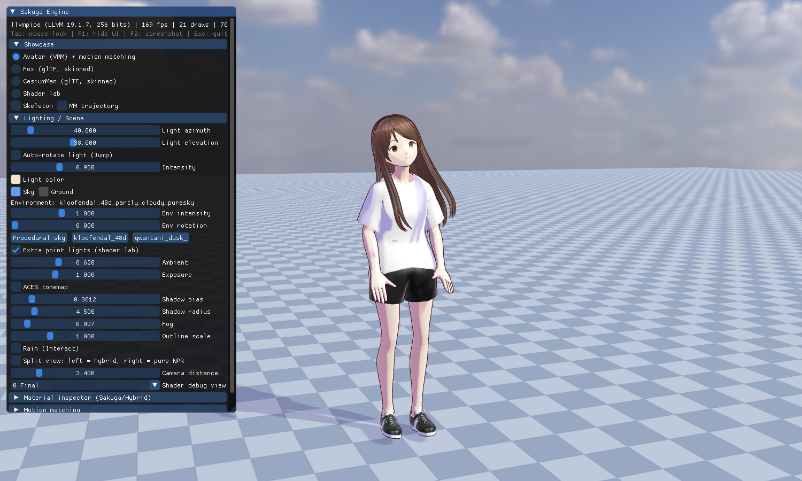
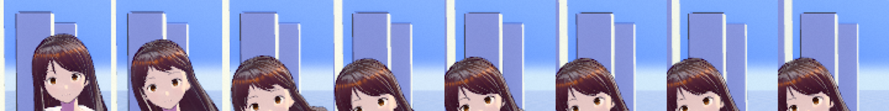

# Sakuga Engine — developer guide

For downloads and a quick overview, see the [main README](../README.md).

A Vulkan 1.3 / C++20 real-time engine for anime-style (NPR) characters and motion: toon shading ported from a Unity URP
shader, VRM avatars with a face SDF light map, motion matching on mocap (LAFAN1), procedural IK and spring-bone hair, and
a sandbox app that shows all of it off.

## Screenshots

All of these are captures of the sandbox in `docs/screenshots/`:

| | |
|---|---|
|  |  |
|  |  |
|  |  |



## What is actually here

| Area | State |
|------|-------|
| Renderer (`engine/gfx`) | Vulkan 1.3 dynamic rendering, 2 directional shadow cascades in one atlas, point-light cube shadow atlas (2 lights x 6 faces, 512^2), bloom, tonemap (Khronos neutral / ACES), grade, LUT, procedural sky + IBL |
| Shading (`shaders/`) | Port of `reference/EndfieldHybrid.shader` (see `docs/SHADER_PORT.md`): hybrid PBR/NPR, ramp + face SDF shading, outlines, wet/rain, split-screen NPR compare, debug views |
| Animation (`engine/anim`) | BVH loader + FK, motion-matching database (features, cached, multi-threaded), inertialized transitions, foot/hand IK, look-at, spring bones, posture layer, mepachi blink |
| Assets (`engine/asset`) | glTF/GLB/VRM loader (cgltf), MToon mapping, face SDF baking, .cube/.3dl/PNG LUT parsing |
| World (`engine/world`) | Box collision world, Recast/Detour navmesh, crowd |
| App (`apps/sandbox`) | Motion lab (mocap browser, motion matching, IK, springs, posture), material inspector, headless screenshot/recording mode |
| `reference/` | the Unity sources the engine ports: `EndfieldHybrid/Debug.shader` and `unity/` (BVH import + pose features), with mapping notes |

## Build

No downloads: GLM, GLFW, the Vulkan **headers**, ImGui, Recast/Detour, cgltf and stb are vendored in `third_party/`
(built from source or header-only), and the compiled shaders are committed in `shaders/spv/`. See
`third_party/README.md` for versions and licences.

```sh
cmake -S . -B build -DCMAKE_BUILD_TYPE=RelWithDebInfo
cmake --build build -j
./build/bin/sandbox --help
```

### Windows build and installer

The same CMake project builds with MSVC; `.github/workflows/windows.yml` does it on `windows-latest` on every push:
set up the MSVC environment, configure with Ninja, build Release, smoke-test the executable (`--help` and
`--dump-ui-theme`, both of which exit before any Vulkan device is created), stage the install tree (`cmake --install`) and
package it with [Inno Setup](https://jrsoftware.org/isinfo.php) into `Sakuga-Engine-<version>-win64.exe`, plus a portable
zip - both are uploaded as the `sakuga-windows-x64` artifact (~53 MB).

```powershell
# what the CI job runs, by hand (from a "x64 Native Tools Command Prompt", or after vcvars64.bat)
cmake -S . -B build -G Ninja -DCMAKE_BUILD_TYPE=Release -DSAKUGA_BUILD_TESTS=OFF
cmake --build build --parallel
cmake --install build --prefix stage                          # stage: sandbox.exe + assets + config + shaders
iscc /DAppVersion=0.1.0 /DSourceDir=stage /DOutputDir=dist installer/sakuga.iss
```

Two things the job had to work around, both now handled in the workflow: `vulkan-1.lib` (the loader import library)
comes from the Vulkan SDK, which the job looks for on the image and installs through chocolatey - or LunarG's installer -
only if it is absent; and the build uses Ninja inside the environment exported by `ilammy/msvc-dev-cmd` instead of
`-G "Visual Studio 17 2022"`, because the hosted images now carry Visual Studio 18 and a pinned generator name fails to
configure ("could not find any instance of Visual Studio"). The GPU-free test suite stays in the Linux `tests` workflow:
several of those tests write to POSIX temp paths.

The installer (`installer/sakuga.iss`) puts the app in `Program Files`, adds Start Menu/desktop shortcuts and an
uninstaller, and warns during setup when no Vulkan runtime (`vulkan-1.dll`) is present. It is themed to match the app,
not left as the stock wizard: generated wizard artwork in the theme palette (`tools/gen_installer_art.py`) with separate
light and dark sets, a background image blended in on Inno 6.7, `WizardStyle=modern dynamic` so it follows the Windows
light/dark setting, a custom icon and on-brand text. `docs/INSTALLER.md` lists exactly how far Inno can be pushed and
where the hard limits are. The staged tree is relocatable -
`sandbox.exe` finds `assets/`, `config/` and `shaders/` next to itself (`findRoot()`), so the portable zip works from
any folder. What is *not* carried by the installer: the Vulkan loader/GPU driver (installed with the graphics driver) and
the 77-clip LAFAN1 set (fetch it with `tools/fetch_assets.sh --motion-only`; the installer ships the two preview clips).

Still needed from the machine (nothing this repo can carry):

* a **Vulkan loader + GPU driver** at runtime, and
* on Linux, the **X11 or Wayland development headers** that GLFW is built against (`libx11-dev libxrandr-dev
  libxinerama-dev libxcursor-dev libxi-dev`). On a headless box, configure with
  `-DGLFW_BUILD_X11=OFF -DGLFW_BUILD_WAYLAND=OFF` to build the engine and the tests without a window backend.
* optional: `glslangValidator` (from the Vulkan SDK) if you want the shaders recompiled from source. Without it the build
  uses `shaders/spv/`; run `./tools/build_shaders.sh` after editing a shader.
* optional: `python3` (standard library only - no numpy/Pillow) for `tools/gen_anime_luts.py` and
  `tools/gen_material_glsl.py`, which regenerate already-committed assets.

Sample assets (models, mocap, LUTs, HDRIs) are vendored in `assets/` too; `tools/fetch_assets.sh` only matters if you want
to re-fetch them or pull the full 77-clip LAFAN1 set.

## The UI: themes, fonts, live editing

The look is data, not code (`engine/gfx/UiTheme.h`): four presets (`Sakuga Dark`, `Sakuga Light`, `Midnight`,
`Monochrome`) plus a JSON file the app loads by default, `config/ui_theme.json`, which is what to edit while playing with
the interface.

```sh
./build/bin/sandbox                                   # loads config/ui_theme.json (falls back to the Sakuga Dark preset)
./build/bin/sandbox --ui-theme Midnight               # a preset
./build/bin/sandbox --ui-theme my_theme.json          # any theme file
./build/bin/sandbox --ui-font ~/fonts/Inter.ttf --ui-font-size 16
./build/bin/sandbox --dump-ui-theme config/ui_theme.json "Sakuga Light"   # writes a preset out as JSON, no GPU needed
```

In the window: **F12** opens the theme editor - preset picker, font scale, panel alpha and ImGui's full style editor
(`ShowStyleEditor`), all applied immediately - plus **Save** (writes the current state back to JSON) and **Reload**.
Editing the `.json` on disk reloads it without restarting (the file's timestamp is watched), so the loop is
*edit JSON -> see it in the running app*. **F11** is the ImGui demo window, **F1** hides the UI, **F2** screenshots,
**F3** FPS, **Tab** releases the mouse.

Fonts: `--ui-font` wins; otherwise the platform's UI font is used (Segoe UI on Windows, DejaVu Sans on Linux, Helvetica on
macOS); otherwise ImGui's built-in bitmap font. `fontScale` in the theme (or the F12 slider) scales whatever was loaded.

## Motion matching: the whole library, every character

`assets/motion/` carries only two clips (`walk1_subject1`, `run1_subject2`) because the full LAFAN1 set is 333 MB and
CC BY-NC-ND -- it cannot be vendored. One command puts all 77 clips in `~/.cache/lafan1`, where the sandbox picks them up
automatically (or point it at any folder with `--motion-dir DIR` / `SAKUGA_MOTION_DIR`):

```sh
./tools/fetch_assets.sh --motion-only      # 77 clips, ~333 MB, each validated to start with `HIERARCHY`
./build/bin/sandbox --help                 # [--motion-dir DIR] [--mm-clips N] [--mm-categories all|bitmask] [--no-mm-context]
```

The hero avatar *and* every NPC in the motion lab share one `MotionDatabase` built from those files, so all of them search
the entire library -- not the two vendored clips. The startup log says what was actually loaded:

```
[sakuga] mm: 77 BVH files found
[sakuga] mm: 77 clips / 496672 frames in use -> Walk x12, Run / sprint x6, Obstacles x17, Jumps x3,
         Interaction (push, multi-action) x10, Dance x8, Fight / sports x5, Aiming x5, Ground / fall-and-get-up x11
```

(and warns when it finds <= 2 clips). What each character may *pick* is then gated per frame by
`anim::resolveCategoryMask()` -- walking/running only reach locomotion families while moving, standing still opens up
dance/fight/aiming/interaction, a jump request unlocks the jump family, and Ground only comes back after a fall -- so the
whole library is reachable without the matcher answering "sit still" to a walk request. `--no-mm-context` turns the gating
off and searches the raw `--mm-categories` mask on every frame (slower, and it can pick anything at any time), and
`--mm-categories all` is the same thing without the mask restriction.

Cost: the full database is 496,672 frames / 473,683 searchable, ~167 MB of poses + 51 MB of features, ~3.3 s to build
(cached afterwards in `~/.cache/sakuga`), and ~6.4 ms per search -- about 31 % of one core for a hero searching at 10 Hz,
so the NPCs search at 0.18 s intervals instead of every frame.

## Tests

The test suite is **GPU-free** (no device, no window server) and runs in CI (`.github/workflows/tests.yml`, every push
and pull request; it also re-runs the asset generators and fails if the committed output is stale):

```sh
cmake -S tests -B build-tests          # picks up the vendored glm automatically
cmake --build build-tests -j
ctest --test-dir build-tests --output-on-failure
```

GPU-free CTest entries, each asserting real behaviour (the full-library entry skips when its clips are unavailable):

| Test | Covers |
|------|--------|
| `sys_info_test` | OS-only memory and storage diagnostics, including unavailable paths |
| `loader_test` | GLB container validation (magic/version/length/chunk bounds), cgltf parse of all vendored `.glb`/`.vrm` files, VRM humanoid map |
| `bvh_parse_test` | BVH parsing against the reference importer's tolerance (case-insensitive keywords, spaced joint names, scientific notation, ms frame times) and rejection of truncated/corrupt files; FK rotation order |
| `mm_search_test` | Motion-matching feature layout, weighted cost + early-out, `MotionMatcher::nearestFrame` against a synthetic database, the movement-context category gating (`resolveCategoryMask`), FK of the vendored mocap |
| `ui_theme_test` | UI theme presets are complete and in range, JSON round-trips, a partial file overrides only what it names, hostile values are clamped, unknown roles ignored, `config/ui_theme.json` matches the built-in preset, and `applyUiTheme` really writes into `ImGuiStyle` (ImGui core is linked without a backend, so still no device) |
| `mobile_session_test` | Android preview's native motion session loads and samples both bundled clips on a synthetic rig |
| `motion_library_test` | Builds a real database from the clips on disk (12 spread over all nine families; `--full` builds all 77), checks every family is reachable, features are normalised, and one search over the whole library stays inside the frame budget. Skips cleanly when the clips have not been fetched |
| `lut_parsing_test` | `.cube`, `.3dl`, LUT PNG parsing; strip layout; malformed files rejected |
| `blink_curve_test` | Mepachi blink curve shape/timing, 3-6 s intervals, seeded determinism |
| `posture_clamp_test` | Posture limits, NaN rejection, hunch chain distribution |
| `shadow_fit_test` | Texel snapping stability, cascade coverage, frustum-slice sphere, point-light face matrices |
| `headless_smoke_test` | Collision world, rig evaluation, 10 s of motion matching with root motion and transitions |
| `pixel_diff_test` | PNG comparison of the reference screenshots + README/image consistency |
| `debug_lines_test` | Line buffer packing, pair integrity, vertex budget, skeleton/polyline builders |
| `face_hair_test` | ZZZ face shading (nose lighten, normal flatten, silhouette aura) and spring-bone physics |

`tests/run_quality.sh` builds and runs the same suite.

## Round 7 corrections

The Round 7 report claimed things the code did not do, and listed verification that never ran. Corrected here:

* **The engine did not compile.** `engine/anim/SpringBone.cpp` referenced an undeclared `entity->springTuningColliderRadius`,
  and `engine/scene/Scene.h` used `exprTarget` / `exprFinal` without declaring them. Both are fixed.
* **The ten "quality tests" were stubs** that printed `OK` and returned 0 without asserting anything; `tests/CMakeLists.txt`
  could not configure (`tests/tests/*.cpp`) and was never added to the build. Real tests + CTest are wired up now.
* **`docs/screenshots/ps_on.png`, `ps_off.png`, `ps_final_cmp.png` and `blink_test.png` never existed** (the report even
  quoted an md5 for one of them). No screenshot is referenced that is not in the repository - `pixel_diff_test` enforces it.
* **Debug lines**: the "line width 2.5" and "camera-facing quad offset" do not exist; the renderer draws a `LINE_LIST` with
  `lineWidth = 1`. The claim is dropped (see `tests/debug_lines_test.cpp` for what the buffer actually does).
* **Spring tuning compounded**: `spring.stiffnessScale *= tuning` ran every frame on the entity's persistent settings, so
  any slider != 1 grew exponentially. Tuning is now resolved into a per-frame copy (`sk::applyTuning`), and the collider
  radius padding is in metres, added once, instead of being double-scaled.
* **ZZZ face shading was wrong, not just unverified**: the nose ellipse multiplied the whole face shadow (erasing it), the
  "85% normal flatten" never touched a normal, and the rim "aura" was brightest at the nose instead of on the silhouette.
  Rewritten as three separate, bounded effects (`engine/gfx/FaceShading.h` + the mirrored block in `shaders/toon.frag`).
* **Blink used unseeded `std::rand()`** (no `srand` anywhere), so every run blinked identically; the curve also jumped back
  to fully closed in its "double blink" branch. Now `anim/BlinkCurve.h` with a seeded RNG per entity.

## Known gaps

* Nothing here has been rendered on a real GPU in the sandbox where this was developed: the engine compiles, all 15 shaders
  compile to SPIR-V with `glslangValidator -V --target-env vulkan1.3`, and the GPU-free suite passes - but frame-level
  visual verification still has to happen on a machine with a Vulkan device.
* No SSAO, no local reflection probes; the near cascade is a single sphere fit (no per-cascade split tuning UI).
* `docs/INSTALLER.md` - the installer's look, how to iterate on it locally, and what Inno cannot do.
* `docs/UNITY_REPO_AUDIT.md` records what the reference Unity project (`Jacinth-19/MotionMatchingInUnity`) contains and which
  of its scripts are dead code; `docs/SCRIPT_AUDIT.md` is the script-by-script audit of that project and of `tools/`.
* `docs/SHADER_PORT.md` lists the remaining differences from the Unity reference shader.

## Licences

* LAFAN1 mocap: **CC BY-NC-ND 4.0 - non-commercial only**, do not redistribute modified copies.
* Seed-san: VRM Public License. three-vrm-girl: "Other" (see upstream). Khronos sample models: CC-BY/CC0.
* Recast/Detour: zlib. Dear ImGui: MIT. cgltf: MIT. stb: public domain. HDRIs: CC0 (Poly Haven).
* three.js LUTs: MIT (per their headers); the `Anime *.cube` tables are generated by `tools/gen_anime_luts.py`.
